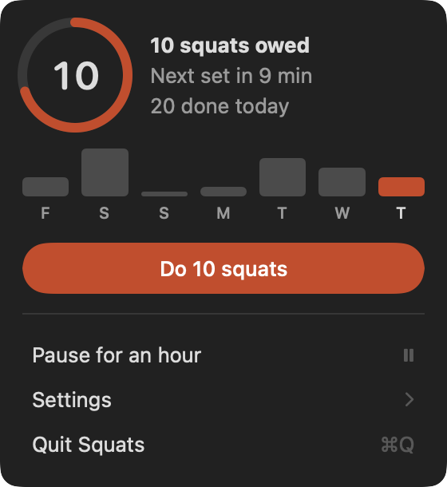
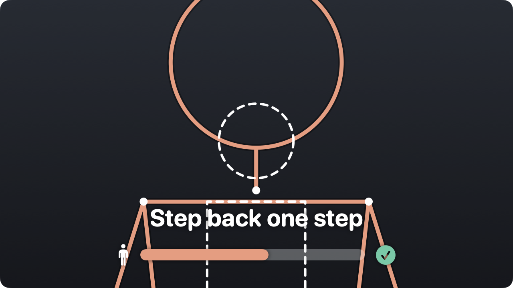
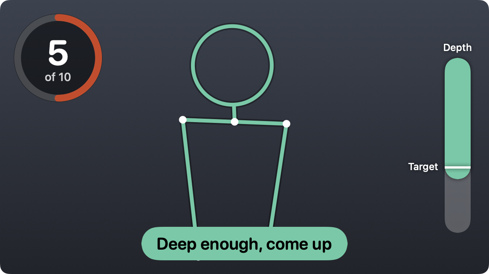

<p align="center">
  
</p>

<h1 align="center">Squats</h1>

<p align="center">
  A Mac menu-bar app that gets you out of your chair.<br>
  It asks for a set of squats every half hour, counts them with your laptop's camera,<br>
  and adds any set you skip to the next one.
</p>

<p align="center">
  <a href="https://github.com/Fakhrillo/squats/actions/workflows/test.yml"></a>
  <a href="LICENSE"></a>
</p>

<p align="center">
  <a href="#install">Install</a> ·
  <a href="#settings">Settings</a> ·
  <a href="#strava">Strava</a> ·
  <a href="#how-squats-are-counted">How it counts</a> ·
  <a href="#known-limits">Known limits</a>
</p>

<p align="center">
  
  
  
</p>

<p align="center"><sub>Drawn by the app's own views. The camera picture behind the figure is left out.</sub></p>

## Why

Sitting at a screen all day makes your back, legs and glutes hurt. A reminder is easy to dismiss,
so this one checks. A set counts only when the camera has seen you do it, and a set you skip is not
forgotten: it is owed.

## How it works

- **It times your sitting, not the clock.** Time counts while you are at the laptop: you touched
  the keyboard or mouse in the last 5 minutes, or you are in a video call. Walk away and the timer
  pauses.
- **Every 30 minutes you owe a set.** A notification offers **Start** or **Skip**, and the
  menu-bar icon shows how many squats you owe.
- **Start opens the counter.** It tells you how many steps to move back. At a good spot you hold
  still for a second, then squat. A figure follows your body, a depth bar shows when a squat is
  deep enough to count, and at the target the window closes and the camera turns off.
- **Skipping is allowed, forgetting is not.** A skipped, ignored or half-finished set stays owed
  and the next one is added to it, up to 30 squats. The count clears at the start of each day.
- **It stays out of your calls.** While another app is using the camera no notification appears.
  It arrives when the call ends.
- **It keeps to your hours.** You can limit it to working hours, and pause it for an hour when you
  can't be interrupted.
- **It shows your week.** The menu has a bar for each of the last seven days.
- **It can log to Strava.** This is optional and off until you connect it. Each day's squats
  become one workout.

## Privacy

- The camera is on only while the counter window is open, and the green light beside the camera
  shows it. The window closes by itself after a minute in which nobody squats, whether you walked
  away or sat back down.
- Frames are processed in memory by macOS's own body-pose model. Nothing is recorded or saved.
- The app makes no network requests unless you connect Strava. Then it talks to Strava only, to
  sign in and to add one workout a day holding your squat count.
- Whether you are at the laptop is worked out without the camera, from the system's idle-time
  counter.

## Install

There is no download yet, so you build it yourself. You need macOS 15 or later, the Xcode
command-line tools and Swift 6. It was developed and tested on macOS 27 on Apple silicon with the
built-in camera.

```bash
git clone https://github.com/Fakhrillo/squats.git
cd squats
scripts/bundle.sh
cp -R build/Squats.app /Applications/
open /Applications/Squats.app
```

Squats lives in the menu bar and has no Dock icon. Allow notifications and camera access when
macOS asks. For a banner that waits for you instead of sliding away, set the Squats alert style to
**Persistent** in System Settings → Notifications.

`scripts/bundle.sh` signs the app with an "Apple Development" certificate from your keychain. If
you do not have one, sign ad hoc instead. macOS may then ask for camera access again after each
rebuild.

```bash
SIGN_IDENTITY=- scripts/bundle.sh
```

To remove it, choose **Quit Squats** in the menu and delete the app from `/Applications`. If you
connected Strava, press **Disconnect** first so that its keys are removed too.

## Settings

Click the menu-bar icon and open **Settings**.

| Setting | Default | What it does |
|---|---|---|
| Squats per set | 10 | How many squats each interval adds |
| Remind every | 30 min | Sitting time between sets |
| Owe at most | 30 squats | Where skipped sets stop piling up |
| Working hours only | off | Reminders and the sitting timer run only between the two hours you pick (9:00 to 18:00 at first), on weekdays only if you want |
| Squat depth | 0.77 | How far your shoulders must drop, in shoulder widths. **Calibrate…** sets it from three of your own squats, and the slider fine-tunes it |
| Sound | on | A tick per squat, a chime when the set is done, and the reminder's own sound |
| Strava | not connected | Sends each day's squats to Strava as one workout. See [Strava](#strava) |
| Start at login | off | Needs the app to live in `/Applications` |

**Pause for an hour** sits above Settings, for a presentation or lunch at your desk. While paused
or outside working hours no sitting time is counted and no reminder appears. Squats you already
owe stay owed, and you can still do a set.

One setting has no switch: more than 5 minutes without input counts as being away. Change it with
`defaults write io.github.fakhrillo.squats idleMinutes -int 10`.

## Strava

Connecting Strava is optional. Once connected, the app adds one "Squats" workout to your Strava
account each morning, holding the count of the day before. It asks Strava for permission to add
workouts and for nothing else.

To connect:

1. Open **Settings → Strava → Connect…**
2. Create an API application at [strava.com/settings/api](https://www.strava.com/settings/api). The
   name, website and icon can be anything. Type `localhost` as the Authorization Callback Domain.
3. Paste the Client ID and Client Secret that Strava shows, press **Connect**, and allow Squats on
   the page that opens in your browser.

You need your own API application because Strava limits a new one to its owner's account, and a
secret cannot ship inside an open-source app.

Good to know:

- Workouts are private ("Only You") unless you untick that in the Strava window.
- **Send today's squats now** sends the day so far. Anything done later goes the next morning.
- Connecting sends nothing from earlier days.
- **Disconnect** ends the app's access on Strava and deletes the secret, the tokens and the Client
  ID from this Mac.
- The Client Secret and the sign-in tokens are kept in your login keychain. With an ad hoc signed
  build, macOS asks for keychain access again after each rebuild.
- The workout's length is an estimate of three seconds a squat, and a finished day is stamped
  18:00.
- A day that could not be sent within a week is dropped. If the connection fails at the moment a
  workout is sent, that day can appear twice.

Mi Fitness, Apple Health and Health Connect cannot be written to from a Mac app. Mi Fitness can
send a band's workouts to Strava as well, which puts both in one place.

Squats is not affiliated with or endorsed by Strava. You connect through your own Strava API
application, under [Strava's API Agreement](https://www.strava.com/legal/api).

## How squats are counted

A laptop camera faces you and mostly sees your head and shoulders, so the usual knee-angle approach
does not work. Instead:

1. Apple's Vision framework finds your body joints in each frame.
2. The app waits until you are a good distance away, judged from how wide your shoulders look, and
   standing still for a second.
3. It then tracks how far your shoulders drop below their highest point of the last few seconds.
   The drop is measured in your own shoulder widths, so distance from the camera does not matter.
   Because the standing level follows you, a reading taken at a bad moment corrects itself.
4. A squat is counted on the way back up. The drop must pass a "down" threshold and then return
   below an "up" threshold, and the whole movement must take at least half a second.

If you move much closer or further away, or leave the frame, it starts over where you now stand
and keeps the count.

## Known limits

Counting:

- It does not judge form. Anything that lowers and raises your shoulders far enough within a few
  seconds counts, such as sitting down and getting straight back up.
- A squat held at the bottom for more than about 5 seconds is not counted, and moving a long way
  back in the middle of a set can cost the next couple of squats.
- The default depth was measured from a single recording of one person at 1.5 m. For a different
  body, desk or camera angle, use **Calibrate…** in Settings.

Where you stand:

- You need room to stand about 1.1 m or more from the laptop. Closer than that it keeps asking you
  to step back.
- The step-back guidance estimates distance from shoulder width, scaled from that same recording.
  On another camera it can be off by a step.

Coverage:

- Built-in camera only, and macOS only.
- Long stretches of reading with no input, and audio-only calls, are not counted as sitting.
- So far it has been used by one person on one Mac running macOS 27. Start at login, and the
  message shown when camera access is denied, have not been tried.

## Development

```bash
swift test                     # ledger, counter, camera lifecycle and Strava requests
swift scripts/make-icon.swift  # redraw the icon
```

The tests also run on GitHub for every push and pull request.

| Path | What lives there |
|---|---|
| `Sources/SquatsKit` | Everything testable without a person: the owed-squats ledger, the rep counter and tracker, the camera-to-pose pipeline, the Strava requests |
| `Sources/Squats` | The menu-bar app: timer, notification, settings, the counter window and the Strava sign-in |
| `Tests/SquatsKitTests` | Unit tests, including a recorded clip of ten real squats (joint coordinates only, no images) |
| `docs/screenshots` | The pictures at the top of this page |
| `docs/superpowers` | The design document and the implementation plan |

## License

MIT. See [LICENSE](LICENSE).
