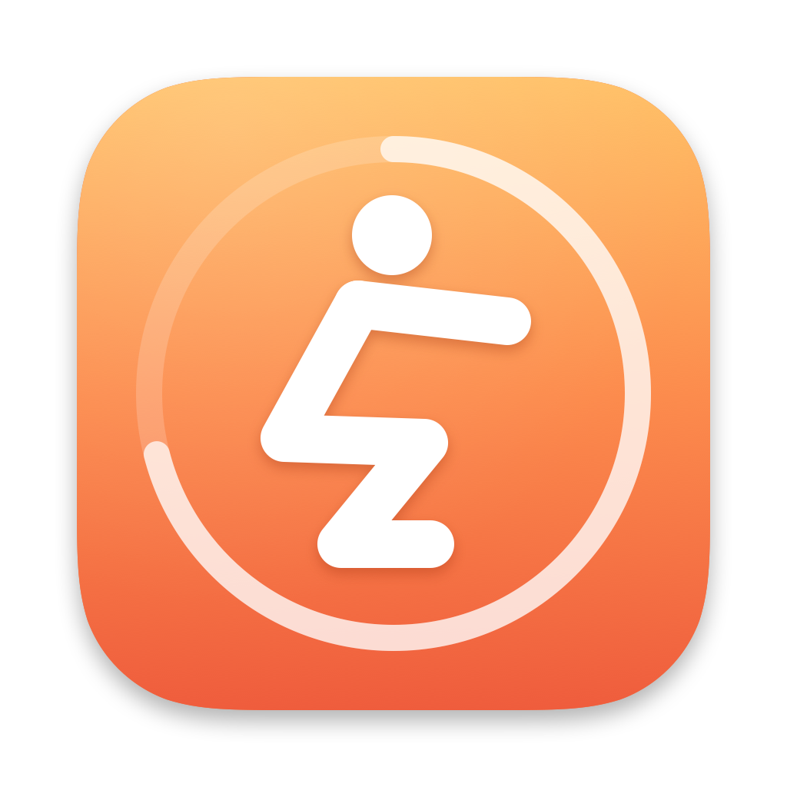

<p align="center">
  
</p>

<h1 align="center">Squats</h1>

<p align="center">
  A Mac menu-bar app that gets you out of your chair.<br>
  A set of squats every half hour, counted by your laptop's camera, with skipped sets added to the next one.
</p>

## Why

Sitting in front of a screen all day makes your back, legs and glutes hurt. Reminders are easy to
dismiss, so this one checks: a set only counts when the camera has seen you do it, and a set you
skip is not forgotten, it is owed.

## How it works

- **It times your sitting, not the clock.** Time counts while you are at the laptop: keyboard or
  mouse input in the last 5 minutes, or a video call in progress. Walk away and the timer pauses.
- **Every 30 minutes you owe a set.** A notification offers **Start** or **Skip**, and the
  menu-bar icon shows how many squats you owe.
- **Start opens the counter.** Step back about 1.5 m, hold still for a second, and squat. Each
  squat ticks; at the target the window closes and the camera turns off.
- **Skipping is allowed, forgetting is not.** A skipped, ignored or half-finished set stays owed
  and the next one stacks on top, up to a cap of 30. The count clears at the start of each day.
- **It stays out of your calls.** While another app is using the camera, no notification appears.
  It arrives when the call ends.
- **It keeps to your hours.** Optional working hours, and a one-hour pause for when you can't be interrupted.

## Privacy

- The camera is on only while the counter window is open, and the green light shows it. The window
  closes itself after a minute with nobody in view.
- Frames are processed in memory by macOS's own body-pose model. Nothing is recorded or saved.
- The app makes no network requests.
- "Are you at the laptop" is answered without the camera, from the system's idle-time counter.

## Install

Requirements: macOS 15 or later, Xcode command-line tools, and Swift 6. Developed and tested on
macOS 27 on Apple silicon with the built-in camera.

```bash
git clone https://github.com/Fakhrillo/squats.git
cd squats
scripts/bundle.sh
cp -R build/Squats.app /Applications/
open /Applications/Squats.app
```

Allow notifications and camera access when macOS asks. For a banner that waits for you instead of
sliding away, set the Squats alert style to **Persistent** in System Settings → Notifications.

`scripts/bundle.sh` signs the app with an "Apple Development" certificate from your keychain. If
you do not have one, sign ad hoc instead; macOS may then ask for camera access again after each
rebuild:

```bash
SIGN_IDENTITY=- scripts/bundle.sh
```

## Settings

Click the menu-bar icon.

| Setting | Default | What it does |
|---|---|---|
| Squats per set | 10 | How many squats each interval adds |
| Every N min | 30 | Sitting time between sets |
| Carry-over cap | 30 | The most you can owe at once |
| Sound | on | Tick per squat, chime when the set is done |
| Squat depth | 0.77 | How far your shoulders must drop, in shoulder widths. Lower it if squats are missed, raise it if small movements count |
| Working hours only | off | Reminders and the sitting timer run only between two hours you pick (9:00 to 18:00 by default), optionally on weekdays only |
| Start at login | off | Needs the app to live in `/Applications` |

**Pause for an hour** sits above Settings, for a presentation or lunch at your desk. While paused or
outside working hours no sitting time is counted and no reminder appears; squats you already owe stay
owed, and you can still do a set.

One setting has no switch: more than 5 minutes without input counts as being away. Change it with
`defaults write io.github.fakhrillo.squats idleMinutes -int 10`.

## How squats are counted

A laptop camera faces you and mostly sees your head and shoulders, so the usual knee-angle approach
does not work. Instead:

1. Apple's Vision framework finds your body joints in each frame.
2. When you stand still for a second, the height and width of your shoulders become the baseline.
3. The app tracks how far your shoulders drop below that baseline, measured in your own shoulder
   widths so that distance from the camera does not matter.
4. A squat is counted on the way back up: the drop must pass a "down" threshold and then return
   below an "up" threshold, and the whole movement must take at least half a second.

If you move closer or further away, or leave the frame, it recalibrates where you now stand and
keeps the count.

## Limits worth knowing

- The thresholds were measured from a single recording of one person at 1.5 m. They may need the
  depth slider for a different body, desk or camera angle.
- Anything that lowers and raises your shoulders far enough counts, including sitting down and
  standing up. It does not judge form.
- Built-in camera only. macOS only.
- Long stretches of reading with no input, and audio-only calls, are not counted as sitting.

## Development

```bash
swift test                     # ledger, counter and camera-lifecycle tests
swift scripts/make-icon.swift  # redraw the icon
```

| Path | What lives there |
|---|---|
| `Sources/SquatsKit` | Everything testable without a person: the owed-squats ledger, the rep counter and tracker, the camera-to-pose pipeline |
| `Sources/Squats` | The menu-bar app: timer, notification, settings and the counter window |
| `Tests/SquatsKitTests` | Unit tests, including a recorded clip of ten real squats (joint coordinates only, no images) |
| `docs/superpowers` | The design document and the implementation plan |

## License

MIT. See [LICENSE](LICENSE).
